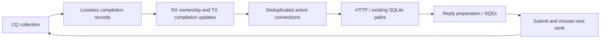

# TODO

## Transport pipeline

Status: RX/TX implementation is functional and tested (phases 1-3). Phase 3 remains open only for the original tail spike's attribution. Phases 4 and 5, storage/layout and scheduling, have not started.

### Goal and baseline

Build a bounded, single-thread pipeline that separates completion collection, RX consumption, request execution and TX submission. Support independent RX/TX lifetimes and persistent multishot receive. Improve CPU/request and latency without changing HTTP, SQLite visibility or commit-before-response behavior.

- Baseline: `5166f4b`, production one-shot receive, CQ collection 128/8 ms, drain cap 256 per ring, write cap 32, provided buffers 1024 x 4096 bytes per ring.
- The [current-kernel control](src/runs/701bae9/ready-cq-http-control/summary.json) used 20.95 us/request with hold p99 18.11 ms at 350k. These are historical reference values, not a substitute for a matched control when testing new code.
- The [primary-ready HTTP candidate](src/runs/701bae9/ready-cq-http-comparison/summary.json) used 6.9% more CPU and raised hold p99 to 58.87 ms. It was removed. Native queue or wait improvements do not establish an HTTP gain.
- Target: stock Ubuntu 24.04 / Linux 6.8, one vCPU, the challenge RAM budget and no swap. Local Docker comparisons keep the existing 1-CPU/2-GiB server limits. Current WSL 6.18 results must remain labelled separately.
- Keep C++23, strict typing, English and the existing formatting. Comments explain ownership or unusual behavior without trailing periods.

### Architecture to implement

These are phases on the existing issuer thread. A request may wait for more input, a commit or a send completion instead of traversing every phase in one pass.

| Record | Owner and purpose |
| --- | --- |
| Connection registry | Each ring owns its slots, generations and connection lifetime. Idle connections are not scanned on ordinary turns |
| Hot connection state | Independent RX/TX state, request phase, queued-work bits, close state and a reference to the cold Exchange |
| Cold Exchange | Existing parser, session and Reply storage, acquired when needed and recycled after its references are gone |
| Completion record | One record per CQE, preserving signed result, operation identity, flags and selected-buffer ownership |
| Active work item | A connection handle plus reasons to run; at most one pending ticket per connection |
| RX backlog | Ordered leases into the existing provided-buffer pool, with preallocated metadata indexed by buffer ID |
| Write batch / SQ | Existing cap-32 transaction batch and ring submission queues; retain their storage between turns |

Completion records and work tickets are different types. Deduplicating work must never discard input, a partial-send result, an error or a terminal CQE. The attachment's 16-byte WorkItem is a sizing idea; measure real records, retain signed errors and do not silently narrow flags.

Prefer typed 64-bit operation tags containing kind, slot and generation, scoped by the CQ's owning ring. Accept, wake, stop and cancellation tags have explicit control identities; they must not be decoded as ordinary connection slots. Work queues carry handles rather than dereferenceable pointers into retired records. Existing DB-batch pointers remain pinned until their batch releases them.

### Scheduling and progress

- [ ] Use one reusable active-work buffer per ring initially. Process RX, application and TX phases over that active set; do not introduce a queue, thread or allocation at every conceptual arrow.
- [ ] Keep a connection's readiness reasons in its hot state. Clear ticket membership when taking work; retain or requeue only work that can actually progress. New RX while a request is DB/TX-busy must not cause repeated dispatch or a busy loop.
- [ ] Start with at most 256 CQEs, 256 connection visits and 256 RX-buffer slices per ring per cycle. Limit one connection to two RX slices per visit before yielding. Carry remaining runnable work in FIFO order.
- [ ] Reserve work-list capacity before consuming a CQE that may add a ticket. If carry-over fills the list, execute stages before collecting more. Queue saturation must not drop a CQE or require an unbounded overflow vector.
- [ ] Allow at most one completed HTTP request to be dispatched per connection visit. A later pipelined request becomes eligible only after the previous response and reset complete.
- [ ] Flush full write batches at 32 and partial batches before blocking. Preserve command order, per-connection order and existing read/write barriers; do not sort SQL requests by endpoint or ID in this block.
- [ ] Submit prepared sends and cancellation SQEs before a blocking wait. Runnable application work, held input that can be consumed, pending commits and close work must be considered independently of `pending_count()`.
- [ ] Keep CQ drain size, kernel wait minimum, timeout and application budgets separate controls. Do not wait for a work buffer to fill.
- [ ] Keep the baseline's numeric empty-CQ policy, 128/8 ms with a 4-ms deferred-RX probe, during the first HTTP pipeline comparison. Runnable work prevents sleeping. Report the integrated pipeline effect rather than claiming that only multishot changed.
- [ ] Exercise wait-one plus bounded drain as a correctness reference. Do not make it the performance default without comparison: the native [wait-policy test](src/runs/701bae9/multishot-wait-policies/summary.json) found higher CPU at 128/512 pingpong connections.
- [ ] Keep wait/drain/timeout settings identical within pipeline or layout comparisons. Any required scheduling change gets its own reference and attribution; do not bundle it into an advertised layout gain.
- [ ] Preserve primary-only SINGLE_ISSUER/DEFER_TASKRUN, satellite notifications, direct descriptors and lazy ring growth. Handle TASKRUN/overflow even with an empty SQ.

### Ownership contracts

- [ ] Replace the shared mutable receive/send Operation identity and exclusive `IoPhase` with independent RX, TX and request states. Define legal transitions before connecting the new collector to HTTP.
- [ ] RX remains active across CQEs with MORE. Retire its pending operation only on its original terminal CQE. Count each submitted SQE and each terminal exactly once.
- [ ] Track cancellation acknowledgements separately from original RX/TX completion. Wait for an acknowledgement only when a cancel was actually issued; natural ENOBUFS has none.
- [ ] Do not rearm an RX identity while its prior original or expected cancel acknowledgement is outstanding. Do not submit a second send while the first still borrows Reply storage.
- [ ] Apply send byte counts and errors exactly once before reducing them to a TX-ready reason. Preserve partial-send retries and immutable in-flight `msghdr`/`iovec`/payload storage.
- [ ] Claim a completed request once. Keep it claimed through DB queuing, commit resolution, response preparation, send retries and the final session reset.
- [ ] New input during that claim may enter the ordered RX backlog, but cannot call `prepare()` again, enqueue the same write twice, reset the parser or modify the current Reply.
- [ ] Keep queued writes owned through commit/error resolution. Peer half-close does not discard an accepted write; server-stop cancellation retains the current policy. A committed command must never be replayed after serialization or send failure.
- [ ] Return selected buffers even for stale generations, cancelled operations and close races. Validate buffer IDs before access; generation checks prevent touching a new connection, not premature freeing of old kernel-borrowed memory.
- [ ] Check generation reuse and wrap. Never allow a wrapped tag to alias an outstanding ticket or operation; retire an exhausted slot rather than silently reusing its identity.
- [ ] Retire a connection only after original RX/TX terminals, issued cancel acknowledgements, close completion, DB references, completion records, RX leases and active tickets have been resolved.
- [ ] Separate `rx_eof` from request-level `close_after`. Drain bytes and complete valid requests already received before EOF in order, then close. Preserve explicit Connection: close, auth/framing failure and incomplete-final-request behavior.
- [ ] Define normal and fatal destruction order. Stop kernel access first; release all backlog/connection leases before `ReceiveBuffers` is destroyed. The current `Ring` destructor resets that pool before member destruction, which cannot remain unchanged once members own leases.

### Bounded input and buffer reuse

- [ ] Keep the current 1024 x 4096-byte provided pool for the first comparison. Preallocate backlog metadata; do not add a heap allocation or grow a vector per CQE.
- [ ] While a request is DB/TX-busy, retain incoming leases in its ordered chain instead of appending more bytes to the busy session. Additional held pool payload is then bounded by the existing 4 MiB per ring.
- [ ] Once the request is eligible, consume an existing session tail first. Feed at most one lease-sized chunk into the session, drive incremental parsing and return that lease promptly. Do not copy a whole queued pipeline into another large string.
- [ ] Keep the current HTTP grammar and limits. URL, individual header field/value and body have 16-KiB checks, but total header bytes and pipeline bytes do not. A staging high-water mark must pause transport, not become a new request rejection limit.
- [ ] Start with a soft pause trigger of two queued RX leases per connection and resume below one. These are experiment settings, not hard per-connection byte guarantees: already selected CQEs can overshoot them.
- [ ] Pause multishot RX through targeted cancellation. Preserve all selected data until consumption; terminal CQEs and cancellation acknowledgements may arrive in either order.
- [ ] Consuming a held lease must not require a receive credit, RX terminal or cancel acknowledgement. Rearming RX requires lifetime/request eligibility and either returned-buffer credit or bounded timed-probe permission.
- [ ] Use returned-buffer credits and a bounded timed probe for ENOBUFS recovery. Do not retry every paused connection on every turn or let newly active work permanently overtake deferred work.
- [ ] Ensure TX, partial-send handling, commit flush, cancel, close and stop need no RX lease to progress. Do not add a circular dependency between RX availability and the response that would release it.
- [ ] Test the all-leases-held case. When a client starts draining an owed response or closes, eligible held input and deferred receivers must resume within the scheduler's bounded work budget.
- [ ] Distinguish internal deadlock from external backpressure. Permanently stalled senders/readers can occupy the shared pool; this plan does not promise fairness for every other reader under that condition. If normal challenge traffic monopolizes the pool, stop and revise the policy before enabling production multishot.
- [ ] Account separately for pool payload, metadata, session tails, parser strings, replies, allocator overhead and kernel sockets. Four MiB of held RX payload is not a four-MiB limit on total ingress memory.

This block does not revive the discarded global byte-admission experiment, per-request scans of all rings, new client timeouts or arbitrary eviction. Any need for those is a new decision.

### Implementation phases and gates

#### 0. Freeze the comparison contract

- [x] Read the current code, both supplied notes and the prior reference findings.
- [x] Record the baseline executable, source patch, generator identity, seed, kernel, cgroup limits and work profile before implementation: [frozen release run](src/runs/5166f4b/release-450000-5m/summary.json), with its private manifest and raw environment.
- [x] Keep `5166f4b` and its existing measurements. Do not run a new baseline merely to restate known results.
- [x] Define native fixture sizes and acceptable measurement spread before the first comparison. Equal bytes, requests, replies and lifecycle work are mandatory.

Native cost screen: one-shot receive, batch128/8 ms, the same 4-MiB pool, 64-MiB streams and 8192 pingpong requests at 16/128/512 sockets. Four pairs alternate A/B and B/A. A median paired CPU regression above both 3% and the controls' relative IQR, with at least three slower pairs, fails the screen. Control IQR above 10% is inconclusive.

Gate: the implementation scope and this plan are approved. No production files change during planning.

#### 1. Screen the pipeline handoff in the native probe

Likely files: `src/benchmarks/receive.cpp`, `src/benchmarks/receive_backend.hpp`, `src/tests/receive_backend.cpp`.

- [x] Add a bounded CQ-collection/RX-consumption handoff to the probe only. Keep the control's one-shot request gate, wait policy, buffer budget and useful work unchanged.
- [x] Measure collection-to-consumption overhead without introducing HTTP, new ownership IDs or a layout change in the same comparison.
- [x] Cover fragmented bytes, multiple CQEs for one connection, independent connections, negative/terminal completions, wrap and full handoff storage.
- [x] Compare CPU, kernel CPU, producer CPU, raw RTT and buffer return/rearm behavior at 16/128/512 connections with short fixed-work runs.
- [x] Treat a repeatable CPU regression outside the controls' own spread as a failed cost screen. Do not compensate by enlarging batches or buffers silently; revisit the number of handoffs first.

The [four-pair screen](src/runs/ed7fa29/receive-handoff-native/summary.json) passes the declared CPU-cost gate: median paired change -0.11% to +2.65%, fixed storage 12,296 bytes, equal bytes/replies, contracts passed. Higher 128-socket RTT is not isolated to the handoff: a [fresh-cgroup check](src/runs/ed7fa29/receive-handoff-latency-check/summary.json) reproduces roughly 30-ms tails in both paths with throttling, versus roughly 1 ms in most unthrottled samples.

Gate: lossless ownership and a justified handoff cost. A native pass permits the ownership work, not an HTTP performance claim. This is a probe experiment, not a temporary second production backend.

#### 2. Build the independent operation and request state model

Likely files: `src/server/net/connection.hpp`, `connections.*`, `reactor.*`, `ring.*`; focused native tests.

- [x] Introduce typed connection/operation identities and their control-tag decoding. Document bit ranges, generation advancement and cancellation matching.
- [x] Separate RX, TX, request and close lifetimes. Remove mutation of one operation kind between receive and send in the new path.
- [x] Implement terminal-only pending accounting, stale-tag handling and the explicit retirement predicate.
- [x] Add native multishot cases for MORE, simultaneous RX/TX, partial send, queued data plus cancel, natural ENOBUFS, EOF and close races.
- [x] Exercise stale slot reuse, late CQEs and generation exhaustion. Confirm selected buffers return exactly once even when the connection handle is stale.
- [x] Verify fatal teardown with live operations and held leases before relying on destructors.

Production state model passed [all 20 release tests](src/runs/ed7fa29/phase2-native-off-v3/summary.json) and the [four affected profile suites](src/runs/ed7fa29/phase2-native-profile-v1/summary.json). The exact generation-exhaustion counter is tested; the store's exhausted-slot branch is reviewed rather than forced through trillions of reuse cycles. Transient RX retries and both cancellation orders are covered.

Gate: state/lifetime contracts pass independently. Do not activate persistent RX in the HTTP server until bounded input and request gating are complete.

#### 3. Integrate the bounded active-work pipeline

Likely files: `src/server/server.cpp`, `src/server/net/*`, session driving in `src/server/http/session.*`, existing transport/session/application tests.

- [x] Connect lossless completion collection, ordered RX backlog and deduplicated ready tickets. Keep record ownership inside the ring/registry.
- [x] Drive session/auth/request execution only when its request phase permits. Keep llhttp, application handlers, SQL/B-tree paths, Reply formatting and commit semantics.
- [x] Keep the existing cap-32 write batch. Preserve its full/partial flush points and raw-target lifetime until responses are staged and the batch is cleared.
- [x] Prepare sends in the TX phase and publish SQEs in groups. Do not mutate an active Reply; dispatch the next pipelined request only after its predecessor finishes.
- [x] Implement the pause/rearm/backlog rules above before production multishot is enabled.
- [x] Make the loop's progress/exit condition include userspace work, held input that can run, pending commits and closing records, not just kernel pending count.
- [x] Add saturation tests for full work lists, exhausted leases, TX-busy input, parser fragments, long valid header sequences, partial sends and repeated pause/resume.
- [x] Add HTTP tests for write-then-read pipelines, duplicate-readiness events, auth/body rejection, half-close with several valid requests, incomplete final requests and stop during a pending commit/send.
- [x] Keep control/stop processing possible at capacity. Verify no dropped bytes, duplicate writes, response reordering, unbounded growth, retry spinning or premature record reuse.
- [x] Make the production cutover directly after its gate passes. Remove the old exclusive-I/O completion path and obsolete APIs; keep historical controls in Git and probes rather than a permanent runtime compatibility switch.
- [x] Run the first matched short 350k HTTP control/candidate pair before changing layouts. Fix the numeric wait settings, drain/pool budgets and write cap; retain the accepted pipeline executable as the next layout control.
- [ ] Before phase 4, isolate the higher tails: hold p99 rose from 18.53 to 74.62 ms in the first 350k pair. Keep the pipeline, workload and numeric wait settings fixed while locating the stalls; do not hide the regression behind layout changes.

Checks: [21 release tests](src/runs/ed7fa29/phase3-regressions-off/summary.json), [five profile suites](src/runs/ed7fa29/phase3-profile/summary.json) and [five ASan/UBSan suites](src/runs/ed7fa29/phase3-sanitized/summary.json) passed. Regression cases cover SEND/data/EOF in one collected prefix, positive terminal RX rearming and TX/stop with all RX leases held. The [updated retry probe](src/runs/ed7fa29/phase3-probes-sanitized-v2/summary.json) also passed with sanitizers.

The [first 350k pair](src/runs/ed7fa29/phase3-http-comparison/summary.json) passed with zero errors: CPU 20.63 to 19.39 us/request (-6.0%, kernel -7.0%), hold p99 18.53 to 74.62 ms, peak RAM +72.73 MiB. No memory-limit events or OOM; both servers exited cleanly. The later release pair below did not reproduce the higher tails.

Tail follow-up: CQ-service timestamps now survive the RX backlog, and retries run after application buffer returns. The new retry regression fails before the fix; [five profile](src/runs/25b8f18/tail-service-hooks-retry-fix/summary.json) and [five off suites](src/runs/25b8f18/tail-service-hooks-retry-fix-off/summary.json) pass afterward. The [350k diagnostic](src/runs/25b8f18/pipeline-retry-tail-diagnostic-350000/summary.json) has hold p99 18.66 ms and zero errors, but no ENOBUFS. Its worst client window overlaps a 55.77-ms commit; the original tail regression remains unattributed.

The [fresh release pair](src/runs/25b8f18/pipeline-tail-release-comparison/summary.json) verifies the functional pipeline at 350k: CPU 20.06 to 19.72 us/request (-1.7%), hold p99 17.61 to 17.57 ms, peak RAM -35.31 MiB, zero errors. The original tail spike did not recur; its attribution gate remains open. No layout or wait-policy tuning was added.

Gate: native, HTTP ordering and exhaustion tests pass and the first HTTP comparison justifies continuing. Do not use a later layout change to conceal a pipeline regression. Parser/application/storage changes outside transport-driving requirements are separate work. If a memory or fairness fix requires new API behavior, stop and revise the plan.

#### 4. Measure storage and locality with the same scheduler

Likely files: `src/server/net/connections.*`, connection storage and the focused native probes.

- [ ] Record release-mode sizes, offsets and allocations for hot records, operation tags, backlog metadata, Exchanges and work items. Report open/active/pooled counts separately.
- [ ] Start from compact AoS hot records and the existing cold Exchange boundary. Compare stable, lazily allocated slot blocks with per-connection allocation before adding AoSoA.
- [ ] Compare small AoSoA blocks for the deduplicated active set where traces show repeated access to the same RX/TX flags, states or buffer indices. Measure block occupancy, unused storage and handle-resolution cost; keep handles valid through growth and reclaim no slot before its lifetime gate.
- [ ] Use SoA only for fields processed together in real bulk loops. Visit active connections rather than scanning the idle registry to manufacture a SIMD workload.
- [ ] Measure locality gains independently of SIMD. Keep wait policy, drain budgets, pool size and request ordering fixed; compare cache behavior where counters are available, CPU/request, RAM and tails. Vectorization remains later work for a measured, regular bulk loop.
- [ ] Retain a layout only with a measured benefit. Remove rejected layout code rather than accumulating template/runtime branches.
- [ ] Confirm a promising layout against the accepted phase-3 pipeline with the same short HTTP workload and wait policy before tuning scheduling.

Gate: stable identity/lifetime tests still pass and the memory/CPU tradeoff is explicit. SIMD, ISA flags and compiler tuning remain outside this phase.

#### 5. Choose the scheduling policy and validate HTTP performance

- [ ] Use one short CPU profile when the new hot path is unclear. Distinguish user CPU, kernel CPU, wall waits and generator work; do not infer blocked duration from CPU samples.
- [ ] Limit wait-policy screening to a few justified candidates. Vary kernel minimum, timeout and user-space work budget independently; keep the full-buffer case and the known-ready-CQE case.
- [ ] Compare wait policies within the same accepted pipeline/layout first. The final comparison against `5166f4b` measures the whole retained change, not the isolated effect of its wait minimum.
- [ ] Check CQ/satellite progress, TASKRUN and overflow with an empty SQ, bounded RX retries and idle blocking. No spinning to manufacture low latency.
- [ ] Compare the chosen candidate with a frozen baseline executable at 350k, seed `20261104`, 30s ramp and 60s hold, using a fresh copy of the seeded DB and the same current generator.
- [ ] Keep internal telemetry, perf and client diagnostics off for the performance pair. Run profiling separately and avoid concurrent builds or competing load tests.
- [ ] Reject late activation, incomplete response coverage, workflow errors or different useful work as performance evidence. Preserve their result records.
- [ ] Report whole-run server CPU/request, hold p95/p99, requests, errors, cgroup memory, buffer/rearm behavior from separate counted runs and generator resource use.
- [ ] Keep performance claims within the controls' measured spread. A CPU/latency tradeoff needs an explicit decision; passing the challenge threshold alone is not an optimization win.
- [ ] Repeat in reverse order only to resolve an actual ambiguity. Run a five-minute confirmation only after a promising short HTTP result; capacity runs are separate evidence.
- [ ] Keep one checked source patch and binary/image identity per run. Publish summaries; keep raw profiles, traces and patches private under their run.

Gate: retain demonstrated gains without changing API behavior or the resource budget. If the pipeline loses, isolate or remove the losing part; do not silently retune unrelated SQL or memory settings to hide it.

### Diagnostics and references

- [ ] Extend existing typed telemetry only where needed: work depth/age, dedup count, held RX bytes/leases, RX/TX/request phases, pause/cancel/rearm and write-batch size.
- [ ] Put timing or bounded flight records in profile mode. Release/off must add no diagnostic clocks, formatting or logging; inspect the generated hot-path code after adding hooks.
- [ ] Distinguish enqueue-to-service age from kernel completion-to-service age. The latter needs kernel event timing; an application timestamp alone cannot supply it.
- [ ] Keep bounded checkpoint event capture useful throughout a run: the latest diagnostic dropped 891 slow-sync and 8579 WAL-advice events. Aggregated histograms and windows remain available.

Use references for specific mechanisms, not as new runtime dependencies:

- [Rust kensac](submissions/rust-iouring-kensac/src/main.rs): persistent receive and stable in-flight send/output ownership.
- [C pavlyhalim](submissions/c-iouring-pavlyhalim/src/server.c): gated reads and buffer-pressure handling; its current source uses multishot poll rather than multishot receive.
- [Alyrn, Loop::HandleCqe](https://github.com/archiyun/Alyrn/blob/main/src/uring/loop.cc): distinguish result publication, kernel retirement and runnable work; separate CQ and ready-work budgets. Its implementation also interleaves work, so it is not evidence that fully separated phases are faster.
- [Helio, UringProactor::ProcessCqeBatch](https://github.com/romange/helio/blob/master/util/fibers/uring_proactor.cc): retain multishot callback identity while MORE is set; recycle only at terminal completion.
- [Seastar reactor](https://github.com/scylladb/seastar/blob/master/src/core/reactor.cc): check scheduled work as well as I/O pollers before declaring the loop idle.
- [liburing](https://github.com/axboe/liburing): MORE, provided buffers, cancellation and queue mechanics. Avoid APIs that require a kernel newer than 6.8.

The newer scored leaderboard revision can differ from the code in this checkout. Reference patterns and submission-authored measurements are not measurements of our server.

### Deferred decisions

- Separate physical RX/app/TX queues only if the single active-set experiment shows a reason to split storage.
- Cross-request read coalescing, result caches and new shared read snapshots.
- New database workers, a SQLite driver, fibers/coroutines, an event bus, a userspace TCP stack, epoll replacement or extra event-loop threads.
- Global byte admission, new client timeout/eviction policies and kernel/network tuning.
- AVX2/AVX-512, PGO, unrolling and new compiler settings. Revisit only a measured hot loop after the ownership/scheduler/layout comparisons.

## Existing experiments and later work

Historical full-profile reference: `d297ca9`, 128 CQEs / 8 ms, 4-ms receive probes and 16 writes per transaction. Current production uses cap 32; the transport baseline above supersedes this as the implementation reference.

- [x] Remove the receive `SOCK_NONEMPTY` hint after the [350k pair](src/runs/701bae9/receive-hint-350000-comparison/summary.json): CPU +1.4%, kernel CPU +2.3%, hold p99 30.16 to 1061.67 ms. Keep native/full results and Docker packaging fixes; tail cause unresolved
- [x] Compare isolated one-shot/multishot receive under WSL 6.18.54.1 ([data](src/runs/701bae9/multishot-receive-native-v2/summary.json)): queued-stream CPU -60.4%, kernel CPU -61.3%, four improving pairs; pingpong inconclusive. Six contracts passed, including MORE, EOF, concurrent send, exhaustion/rearm and cancellation races. Production server matches the no-hint binary
- [x] Profile both receive modes ([data](src/runs/701bae9/multishot-receive-profile-all/summary.json)): 9,819 samples, no loss, one actor PID per capture. Stream removes receive setup/poll work; pingpong retains its 100k sends and loopback peer wakeups. CPU samples do not measure blocked time
- [x] Detect dense/sparse registered-file listings in transport tests. Linux 6.18 omits empty slots; preserve the old-kernel lock-failure guard. The [first check](src/runs/701bae9/multishot-receive-native/summary.json) stopped before timing; the corrected suite passed
- [x] Compare multishot with 16/128/512 connections and CQ 128/8 ms ([data](src/runs/701bae9/multishot-receive-many/summary.json)): four rotated pairs, equal bytes/ACKs, same 4-MiB pool. At 128/512 sockets, stream CPU -40.8/-42.8%, pingpong -8.5/-4.8%; 128-stream elapsed +56.1%. Six suites passed, plus the [empty deferred-wait check](src/runs/701bae9/multishot-receive-many-check-v2/summary.json); the checked probe binary matches the timed one
- [x] Isolate the 128-socket wait regression ([data](src/runs/701bae9/multishot-128-analysis/summary.json)): a known-ready CQE waits 8.03 ms at target 128. CQ 32 cuts native stream wall time from 309 to 58 ms; extra buffers alone reach 152 ms
- [x] Compare ready-first and wait-one at 16/128/512 sockets ([data](src/runs/701bae9/multishot-wait-policies/summary.json)). Ready-first improves streams; wait-one lowers pingpong p99 but costs more CPU at 128/512. Six suites passed, including queued SQEs, deferred work, cancellation and the 256-CQE bound
- [x] Reject the primary-ready-only HTTP change after the [350k pair](src/runs/701bae9/ready-cq-http-comparison/summary.json): CPU 20.95 to 22.38 us/request, hold p99 18.11 to 58.87 ms. Both passed with zero errors; restore production and keep the native experiments
- [x] Approve the proposed transport pipeline above before implementation; keep parser/application/storage and complete each phase's gate before moving on

- [x] Capture the [five-minute profile](src/runs/d297ca9/baseline-full-profile-350000-5m-analysis/summary.json): 217,114 CPU samples, no lost records, 20.56 us/request and zero HTTP errors. Recover the saved data after the original decoder timeout
- [x] Keep cap 32 after the 16/32-write comparison: 3.2% less CPU and 2.4% less kernel CPU in the short pair. The historical full-profile reference remains cap 16
- [x] Test cross-turn write accumulation at cap 32 ([0/1/0-ms comparison](src/runs/79cd8ce/write-window-comparison/summary.json)): 21.30 / 21.13 / 20.52 us/request. No demonstrated CPU gain; remove the deadline path and keep end-turn flushing. Off/profile lifetime, ordering, error and shutdown tests passed
- [x] Compare bounded WAL-write coalescing ([350k pair](src/runs/79cd8ce/wal-coalescing-350000-comparison/summary.json)): 20.78 to 20.40 us/request (-1.84%), kernel CPU -2.04%, p99 20.11 to 20.28 ms, zero errors. Keep the candidate; five native contracts passed, including commit visibility, rollback, errors and eviction
- [x] Implement one-shot B-tree post reads with fresh snapshots and SQL fallback. Six native contracts passed; the [common-case Application probe](src/runs/03180a1/btree-post-common-native/summary.json) used 1.72 to 1.34 us/read (-22.4%) with identical status/JSON
- [x] Compare direct post reads at 350k with WAL, cap 32 and CQ 128/8 ms fixed ([A/B/B/A](src/runs/6cd248e/post-btree-abba-350000/summary.json)): weighted SQL 20.51 versus B-tree 20.88 us/request (+1.79%). One B run failed p99 despite zero errors; the initial -0.74% pair was not confirmed
- [ ] Investigate the B control's tail stall: hold p99 1.30 s, max 4.87 s. The [sampled 35-54s window](src/runs/6cd248e/post-b2-window-analysis/summary.json) shows 86% CPU versus 67-69% in controls. Commit/ENOBUFS timings are unavailable; large full-run throttle/retransmit totals mostly belong to teardown. Cause remains unknown
- [x] Compare listener TCP_NODELAY off/on ([pair](src/runs/6cd248e/tcp-nodelay-350000-comparison/summary.json)): total CPU -0.03%, approximate hold CPU +0.35%, segments/request effectively unchanged, zero errors. Remove the candidate and keep the default
- [x] Screen disassembly candidates: keep required-header capture and direct reply formatting after [native comparisons](src/runs/6cd248e/http-disassembly-native/summary.json) and four focused contracts. Discard duplicate point-read initialization; its comparison was inconclusive. Full-server gains remain unconfirmed
- [x] Keep the consumed-input offset after the [native comparison](src/runs/146d5f2/session-offset-native/summary.json): body CPU -4.6%, pipeline32 -13.8%; ordinary GET and fragmented-body results inconclusive. Session +8 bytes, retained capacity unchanged; fragments, pipeline order, reset and buffer bounds passed
- [x] Compare the offset at 350k ([control/repeat](src/runs/146d5f2/session-offset-350000-comparison/summary.json)): total CPU -0.73%, approximate hold CPU +0.50%, hold p99 18.56 to 21.02 ms. Both valid runs passed; first offset attempt activated late. No full-server gain established
- [x] Remove stored header names and swap completed authorization buffers ([probe](src/runs/89b5d0c/parser-buffers-native/summary.json)): Parser 336 to 304 bytes, first auth allocation count 2 to 1, warm 0 in both; four contracts passed. Fragmented capacity rises 502 to 540; CPU results are noisy, no whole-server gain measured
- [x] Reject deferred RELEASE ([production probe](src/runs/429574d/savepoint-release-native/summary.json)): batch 32 foreground CPU +116.9% valid / +131.1% mixed; all eight pairs slower. Six contracts passed. Restore per-write RELEASE; retain production probe and new trigger-isolation tests
- [x] Reject incremental WAL advice after the [350k comparison](src/runs/429574d/wal-ranges-350000-comparison/summary.json): CPU 22.03 to 22.72 us/request, hold p99 22.77 to 408.79 ms, RAM +23.64 MiB. Native helper gains did not carry through. Initial control activated late; its valid repeat is the comparison. Keep results, restore the existing advice path
- [ ] Compare checkpoint notification cadence separately if measured costs justify it; advice used only 0.72% of long-profile CPU
- [x] Reject create-only borrowed body binding after the [native comparison](src/runs/429574d/create-body-borrow-native/summary.json): valid batch-32 CPU +12.6%, all four pairs slower; mixed results inconclusive. Lifetime/rollback contracts passed; keep `SQLITE_TRANSIENT`
- [ ] Screen parameterless-statement cleanup only if a current profile justifies it; all binding cleanup sampled just 0.037% of short-profile CPU
- [ ] Keep persistent satellite notification polling for later; wakeup handling is no longer a measured hotspot after READ

Screen small SQL changes with focused tests and fixed-work native probes. Use one short matched 350k A/B with perf off for promising changes, changing one mechanism at a time.

Record user/kernel CPU per request, useful work, commits, RAM, errors and p99. Reuse controls only while source, workload and instruments match. Repeat only to resolve an inconclusive result; capacity tests follow a retained gain.

## Later

- [ ] Attribute kernel slab at a fixed hold point and after draining, then allocation reuse and socket-buffer caps in Ideas.md order. The [450k diagnostic](src/runs/ed7fa29/diagnostic-450000-60s/summary.json) is dominated by kernel/slab, with memory-limit events but no OOM kills
- [ ] Resolve missing profile telemetry after the 450k server exits 137 during cleanup; confirm graceful shutdown and export before relying on internal commit/rearm counters
- [ ] Split foreground COMMIT stalls into sync/write/retry time and waiting before receive service; compare multishot receive afterward
- [ ] Test capacity on comparable Linux hardware with a separate generator and the official file limit
- [ ] Finally move our source/docs into `submissions/<stack>-SmolBlackHole/` and rename SUBMISSION.md to README.md

Keep our code in `src/`, use English and strict typing, and leave upstream files and other submissions alone
